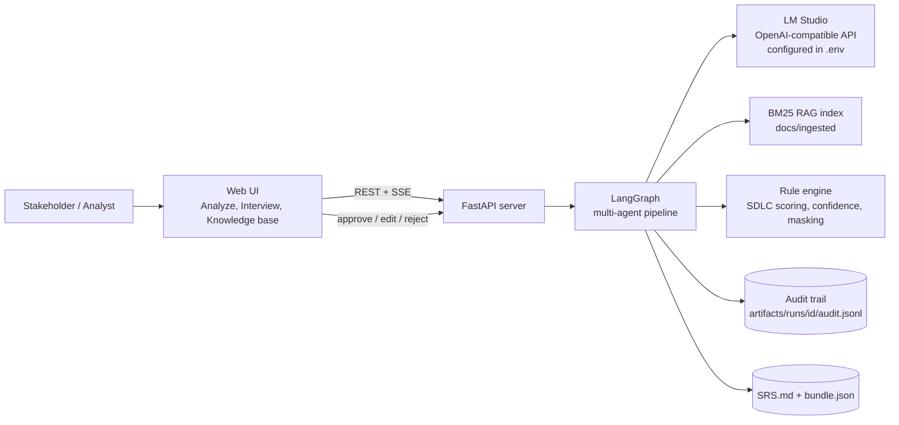
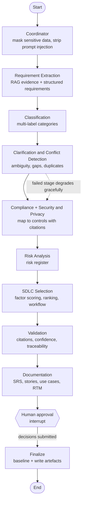
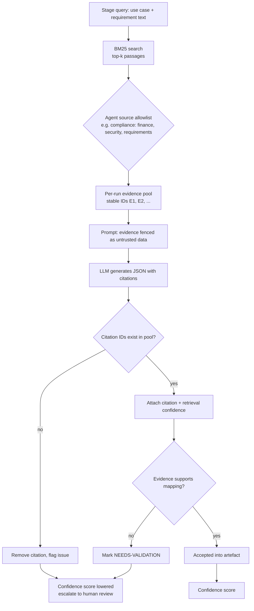
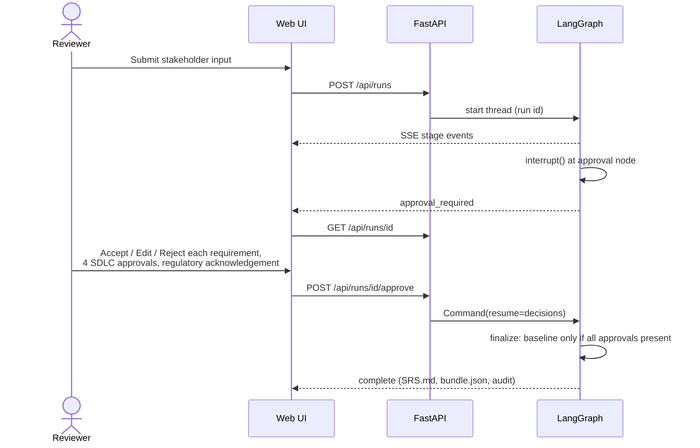
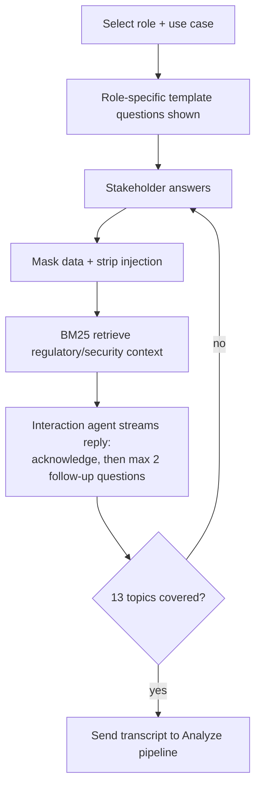
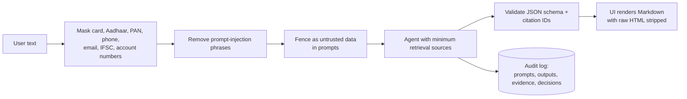

# ZPay - Architecture and Flowcharts

ZPay is an agentic requirements-engineering assistant for financial services, built from the *Problem Statement*. It gathers requirements (interview or document), analyses them against a retrieval-grounded knowledge base, recommends an SDLC model and produces audited artefacts, with a human approving every critical decision.

## 1. System overview



## 2. Mastra replacement

Mastra is TypeScript-only. ZPay uses **LangGraph (Python)**, the closest equivalent: agents, a durable workflow graph, checkpointed state and human-in-the-loop suspend/resume.

| Mastra concept | ZPay equivalent |
|---|---|
| `Agent` + instructions | Agent prompts and retrieval allowlists in `zpay/agents.py` |
| `createWorkflow` / `createStep` | `StateGraph` nodes in `zpay/pipeline.py` |
| Workflow `suspend()` / `resume()` | LangGraph `interrupt()` and `Command(resume=...)` |
| Storage / memory | LangGraph `MemorySaver` checkpointer (per-run thread) |
| Workspace BM25 + input processor | `zpay/rag.py` + evidence injected per stage |
| LM Studio via AI SDK provider | `langchain-openai` `ChatOpenAI` pointed at `LM_STUDIO_BASE_URL` |
| Studio UI | Custom web UI in `web/` |

## 3. Multi-agent pipeline (LangGraph)



Stage failures (bad JSON, etc.) become warnings and the run continues; only an unreachable LM Studio aborts the run.

## 4. Retrieval-grounded generation



**Confidence per requirement** = 0.30 base + up to 0.35 (best cited-passage retrieval confidence) + 0.15 (acceptance criteria) + 0.15 (verbatim stakeholder source found in input) + 0.05 (evidence-backed control mapping) - 0.08 per open issue (max 3). Below 0.60, or regulated with no evidence, the requirement is escalated as **needs-review**.

## 5. SDLC selection engine

Models: Waterfall, V-Model, Spiral, RAD, Prototype, Agile (XP), Agile (Scrum), Iterative.

```mermaid
flowchart LR
    REQ[Requirements + risks + input] --> LLM1[LLM scores 10 factors 1-5<br/>with reasons citing requirement IDs]
    LLM1 --> CL[Clamp to 1-5]
    CL --> ENG[Deterministic engine<br/>weighted distance to each model's ideal profile]
    ENG --> RANK[Ranked list<br/>e.g. Iterative 81%, Spiral 71%, V-Model 70%]
    RANK --> TOP[Top model]
    TOP --> LLM2[LLM fills phases:<br/>activities, roles, deliverables,<br/>security, compliance, gates]
    LLM2 --> WF[Project-specific workflow + Mermaid diagram]
    WF --> HUM{{Approval: Project manager,<br/>Architect, Security, Compliance}}
```



Factors: requirement stability, regulatory criticality, security risk, uncertainty, change frequency, delivery speed, verification need, stakeholder availability, failure consequence, complexity. Regulatory, security and failure-consequence factors are weighted 1.5x. The LLM only *explains and customises*; the ranking is rule-based and reproducible.

## 6. Human-in-the-loop sequence



A baseline is created only when every non-rejected requirement is approved, all four SDLC roles approve, and regulatory acknowledgement is given. Otherwise the status stays *DRAFT*.

## 7. Adaptive stakeholder interview



## 8. Security controls



| Control (problem statement section 17) | Status |
|---|---|
| Sensitive-data masking before LLM | Implemented (`zpay/security.py`) |
| Prompt-injection protection | Implemented: phrase removal, data fencing, schema validation |
| Retrieval-source allowlisting / agent-level permissions | Implemented per agent (`zpay/agents.py`) |
| Audit logging of prompts, evidence, decisions | Implemented (`audit.jsonl`) |
| Model and knowledge-base versioning | Model name and corpus SHA-256 recorded per run |
| Session isolation | Per-run LangGraph thread and evidence pool |
| Output filtering | JSON schema validation, citation verification, HTML stripped in UI |
| RBAC, MFA, encryption at rest, retention policies | **Not implemented** - prototype is local single-user; add an identity provider / reverse proxy for production |

## 9. Artefacts produced per run

`artifacts/runs/<run-id>/`

| File | Content |
|---|---|
| `SRS.md` | Requirements, user stories, acceptance criteria, use cases, compliance matrix, risk register, traceability matrix, assumptions, open issues, SDLC recommendation + workflow, metrics, evidence |
| `bundle.json` | Full structured result |
| `audit.jsonl` | Append-only trail of every stage, prompt, model output, retrieved evidence reference and human decision |

## 10. Sample input

Paste this into **Analyze** (or click *Load sample*). Use case: *Payment processing*, role: *Business analyst*.

```text
We run an online marketplace in India and need a payment processing system supporting UPI, credit/debit cards, net banking and wallets. We expect about 50,000 transactions per day, rising during sales events. Payments must go through Razorpay. Customers should get an instant confirmation and be able to request refunds. Transactions above INR 50,000 need extra authentication. We must comply with RBI rules and PCI DSS and keep card data out of our systems. Fraud checks should happen in real time. Finance needs automatic reconciliation with bank statements every day and audit logs kept for at least 5 years. The service should be fast and always available. Our team is small, the launch is in 4 months, and the requirements may change as the business grows. Contact: ops@example.com, 9876543210.
```

What to expect:

- The e-mail address and phone number are masked (`[EMAIL]`, `[PHONE]`) before reaching the model.
- Requirements such as multi-method payments, step-up authentication above INR 50,000, refunds, fraud checks, daily reconciliation and 5-year audit logs are extracted.
- Vague phrases like "fast" and "always available" are flagged by the clarification agent with follow-up questions (e.g. target latency, uptime).
- RBI and PCI DSS mappings cite passages from `docs/ingested`; unsupported ones show `NEEDS-VALIDATION`.
- Changing requirements, a small team and regulation push the SDLC ranking toward iterative or Agile-style models with verification gates; the exact ranking depends on the model's factor scores.

### Sample interview answers (Interview tab)

1. "We want to let marketplace buyers pay by UPI and cards, and give sellers daily settlement."
2. "Buyers and sellers use it, plus our finance team for reconciliation. Refunds need finance approval above INR 10,000."
3. "We must keep transaction logs for 5 years and report to RBI when required."

## 11. Project layout

```
ZPay/
├── main.py                # starts the server
├── requirements.txt
├── .env / .env.example    # LM Studio connection + settings
├── zpay/
│   ├── config.py          # env loading
│   ├── llm.py             # LM Studio client, JSON validation, streaming
│   ├── rag.py             # BM25 index, evidence pool, citations
│   ├── security.py        # masking, injection screening
│   ├── agents.py          # agent registry, prompts, role templates
│   ├── sdlc.py            # SDLC scoring engine + diagrams
│   ├── pipeline.py        # LangGraph multi-agent graph + HITL
│   ├── render.py          # SRS Markdown generation
│   ├── runs.py            # run registry + audit trail
│   └── app.py             # FastAPI routes
├── web/                   # static UI (no build step)
└── docs/                  # knowledge base (docs/ingested) + this file
```
